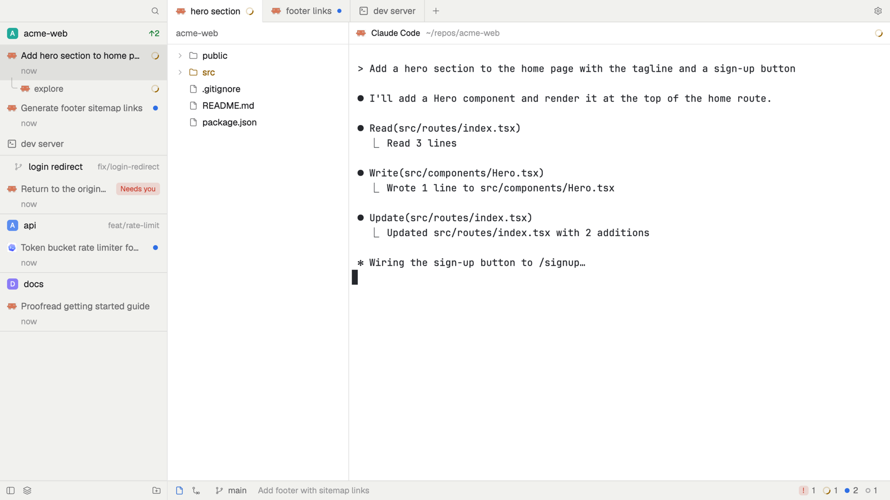

# Zebra

A flat, editor-style window: spaces and tabs as projects and threads in one
sidebar, Files and Changes beside edge-to-edge panes, and a thin status bar.



This file is the brief: enough to build Zebra from an empty folder. The
files next to it are one build of it. If they don't work on your Herdr, or you
want it different, build it again from here.

## What you see

Two columns, left to right, with no system title bar. On macOS the traffic
lights sit at (10, 9) over the sidebar's top bar.

1. **The sidebar**, 240px wide (resizable, 160–480px), `chrome`. A 32px top
   bar leaves 72px for the traffic lights and has search on the right. The
   list has one group per space, each closed by a 1px line. A 32px space
   header shows a 16px rounded square in the space's color with its bold
   white initial, the name, and in 11.5px `dim` only what is unusual: the
   repo when the name doesn't say it, a branch other than main/master,
   `↑n` in `ansi2`, `↓n` in `ansi1`. A worktree space sits under its main
   checkout with a branch icon and 20px more indent. Each tab is a row,
   padding 4px × 10px: a 14px program icon, the agent's conversation title
   (else the tab's name, else the terminal's title) and the state mark,
   then how long ago it changed (`now`, `5m`, `3h`, `2d`, `3mo`) in 12px
   `dim`. The selected row is `selected` edge to edge. Sub-agents hang
   under their parent in 24px rows with 1.5px tree lines. Pinned agents
   gather in a "Pinned" section on top. With more than one machine, a 28px
   machine header starts each machine's spaces. A 28px bottom bar holds
   hide-sidebar, the view toggle (layers = by space, clock = by priority)
   and a folder-plus for a new space.
2. **The work column**, the flexible width. A 32px tab bar of flat tabs,
   12px padding, 1px lines between: the selected one `background` with no
   bottom line, the others `chrome`. Each shows its program icon, name and
   state (spinner, or a 6px dot). A plus follows the last tab; a gear sits
   far right with a 5px `accent` dot when an update is ready. With the
   sidebar hidden, the bar starts with 76px for the traffic lights and the
   space's name. Below, a hidden 260px panel (resizable, 180–900px) stacks
   Files and Changes under a 32px header with no title. The panes have no
   gaps, 1px lines, no radius and a 32px header on every pane: program
   icon, name, folder, state, and on hover split right, split down, zoom
   and close. Terminal padding is 4px left and right. A 28px status bar,
   12px `muted`, has the Files and Changes toggles, the machine for remote
   spaces, the branch and the last commit's subject in `dim`, then on the
   far right the number of agents in each state.

Icon buttons are 22px with 14px icons, `accent` while their panel is open.
Colors are theme names only (`chrome`, `background`, `border`, `muted`,
`dim`, `hover`, `selected`, `accent`, `working`, `blocked`, `done`,
`ansi1`–`ansi3`); the layout sets no theme.

## How it behaves

- **States.** working: a 12px spinner. blocked: a "Needs you" badge on 15%
  `blocked`, or a 14px "!" where a section already says it. done: a 7px
  dot. idle: nothing in the sidebar, a 7px ring in the status bar. A
  sub-agent's done shows as idle and its error as blocked.
- **Sidebar.** Click a space header to fold it; drag it onto another to
  move the space; hover shows a plus for the new menu. Click a row to show
  its tab; hover shows a pin. Click a sub-agent to peek at it. Right-click
  opens the space or tab menu. By priority groups rows into Needs you,
  Done, Working and Idle, reading "space · title". `cmd-]` / `cmd-[` follow
  the order shown.
- **Tabs.** Click to show, drag to reorder, double-click to rename, scroll
  to switch; hover lays a close button over the right end. The open panel
  is remembered per space.
- **Files.** A tree of the focused pane's folder in 24px rows, colored by
  git status (added `ansi2`, modified `ansi3`, deleted `ansi1`). Clicking a
  file previews it read-only; Edit opens it in an editor pane to the right.
- **Editor pane.** A 28px header with the path, a dot while unsaved and any
  save error. `cmd-s` saves only if the file on disk is still what was
  loaded; it reloads when the file changes and nothing is unsaved.
- **Changes.** The changed files and the selected file's diff, the first
  one open by default.
- **Status bar.** Clicking the counts goes to the next agent.

## Built from

- **The layout** (`layouts/zebra.json`), cloned from Herdr's `main`:
  ```
  root row (titlebar none, traffic_lights [10, 9], terminal_padding [4, 0], divider 1px)
  ├ sidebar column 240px (chrome)
  │ ├ brand block 32px, window_drag  → zebra-workspace-chrome
  │ ├ threads block                  → zebra-sidebar
  │ └ sidebar-bottom block 28px      → zebra-workspace-chrome { footer: true }
  └ work column
    ├ tabs block 32px, window_drag   → zebra-tabs
    ├ work-body row (divider 1px)
    │ ├ panel column 260px, hidden
    │ │ └ panel-body stack: files → zebra-files, changes → zebra-changes
    │ └ main block (background border): { tab: "active", pane: { gap 1, radius 0, background, lone, header 32px → zebra-pane } }
    └ status block 28px              → zebra-status
  ```
  The mods find the ids `sidebar`, `panel`, `panel-body`, `files` and
  `changes`.
- **Eight mods** (`mods/zebra-*/`), all `place: "none"`. `zebra-sidebar`
  and `zebra-editor` are new; the rest are cloned from Herdr's
  `workspace-chrome`, `tabs`, `files`, `changes`, `pane` and
  `workspace-status`, recorded as `cloned_from`.
- **Shipped parts:** `menu`, `new-menu`, `picker`, and the
  `workspace-chrome` spinner, server and branch SVGs and `pane/close.svg`.
- **APIs:** `machines()`, `setAgentOrder()`, `writeTextFile(path, text,
  expected)`, `watchFolder()`, `nextCommand()` and `EditorState`/`Editor`
  besides the usual ones. `shared()` keeps `space.colors` and `zebra.sort`;
  `localStorage` keeps folds, pins and the panel per space.
- **Commands:** `pane.split {direction: "right", mod: "zebra-editor",
  props: {file}}`, `space.move`, `terminal.peek`, `agent.next` and
  `layout.show`/`hide`/`select` besides the usual space, tab and window
  ones.
- **Programs:** `git` (`status`, `rev-parse`, `diff`, `log`) and `sh` on
  the space's machine; `hc machine ls --json`.
- **Timers:** git is asked when a space moves, a turn ends or the repo
  changes, with a 60s fallback. Files and Changes also refresh every 10s.
- **Keys** (`keys.json`): only the `mod:zebra-editor` section (`cmd-s` for
  `zebra-editor.save`), merged into the person's existing keys. The other
  sections are the author's own keys, not part of Zebra.

## Watch out

- A mod in a layout block never gets the keyboard, so the editor is a pane
  mod and Changes has no commit box.
- `pane.split` always puts the new pane to the right, and a pane mod's
  `props()` has no pane id.
- `svg()` caches by path until restart, and `tooltip()` does not show in
  layout blocks.
- Edit hides for remote spaces. Files lists up to 5,000 entries; Changes up
  to 1,000 files and 1,500 diff lines.
- Only macOS was tried; elsewhere the tab bar draws window buttons.
- If names are taken, rename the layout, the `zebra-*` mods and their
  `mods/zebra-*/…` paths and `keys.json` together.

## Done when

- The sidebar lists every space with one row per tab, the branch appears
  for a space on another branch, and `cmd-]` follows the rows.
- An agent going working → blocked → done changes its row, its tab and the
  status bar counts.
- Files → a file → Edit opens an editor pane; `cmd-s` writes the file.
- Hiding the sidebar puts the space name in the tab bar.
- `herdr-app check` passes for every mod but `zebra-changes` (it panics in
  gpui, as Herdr's own `changes` does), and switching away and back works.
